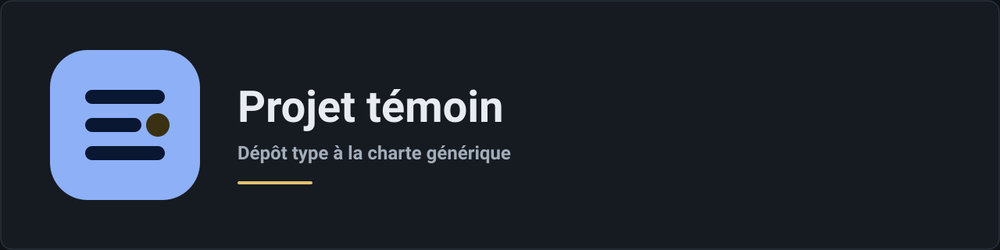
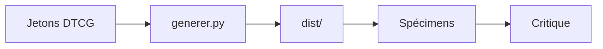
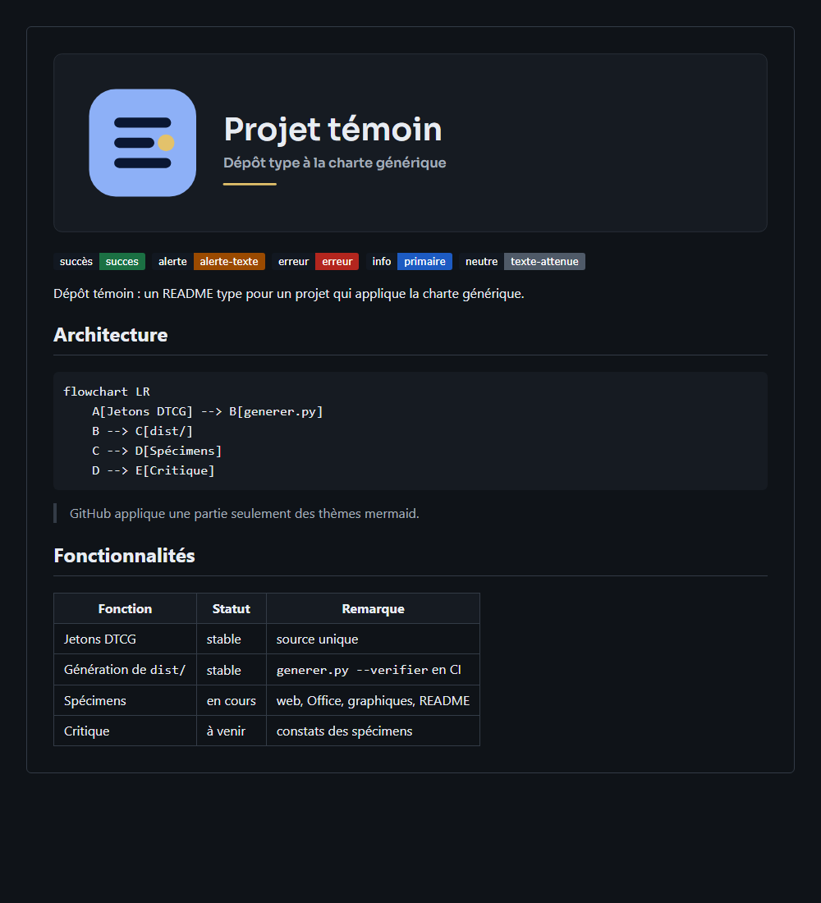
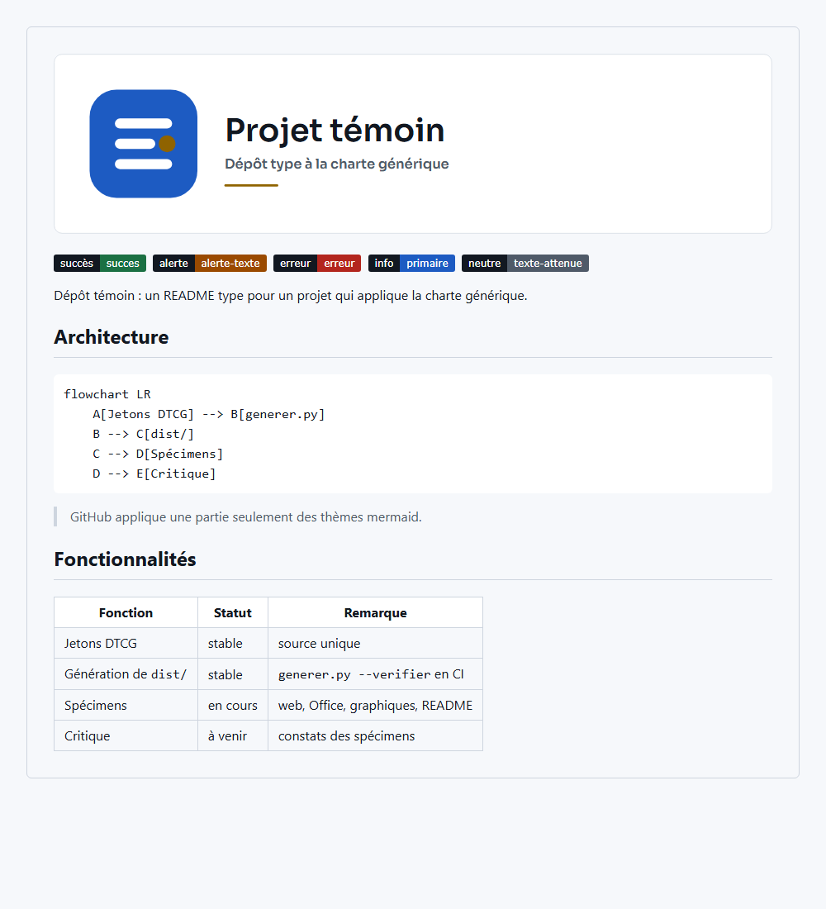

<picture>
  <source media="(prefers-color-scheme: dark)" srcset="banniere-sombre.svg">
  <source media="(prefers-color-scheme: light)" srcset="banniere-clair.svg">
  
</picture>

    

Dépôt témoin : un README type pour un projet qui applique la charte générique.

## Architecture

> Note : GitHub applique une partie seulement des thèmes mermaid (`themeVariables`) et ignore
> `%%{init}%%` dans certains contextes de rendu. `rendus/mermaid.png` montre l'intention.

## Fonctionnalités

| Fonction | Statut | Remarque |
|---|---|---|
| Jetons DTCG | stable | source unique |
| Génération de `dist/` | stable | `generer.py --verifier` en CI |
| Spécimens | en cours | web, Office, graphiques, README |
| Critique | à venir | entrée : constats des spécimens |

## Captures

| Sombre | Clair |
|---|---|
|  |  |
